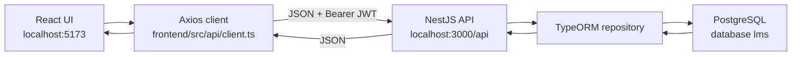
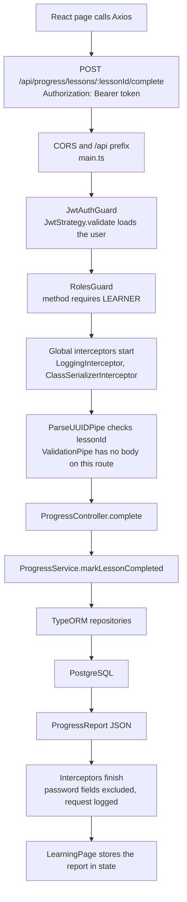
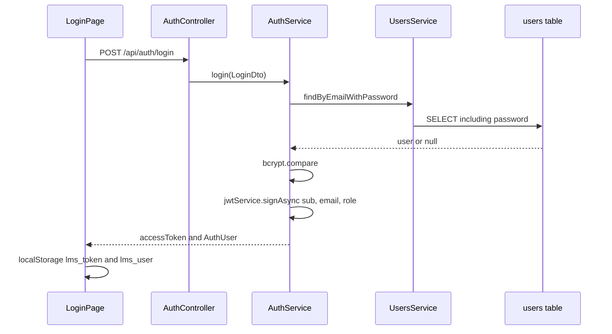

# Developer guidelines and project learning guide

This guide explains the eLearning Management System in this repository. It is written for a developer who can read TypeScript and has only a basic idea of NestJS. Every class, method, path, and example below comes from the code in this project.

Setup commands, sample accounts, and how to start the app are in [README.md](README.md). The database picture is in [documentation/database-erd.md](documentation/database-erd.md). The API collection is [postman/LMS.postman_collection.json](postman/LMS.postman_collection.json).

When a behavior in this guide no longer matches the code, update this file in the same change.

## 1. Project overview

### What the application does

The LMS is a local learning application with three roles:

- **Admin** creates users (including instructors), sees every course, and reads every report.
- **Instructor** creates and publishes courses, modules, lessons, and quizzes, but only for courses they own.
- **Learner** browses published courses, enrolls, reads lessons, marks lessons complete, and submits quizzes.

Public registration always creates a learner. Instructor accounts are created by an admin. A course starts as a draft and becomes visible to learners only after it is published.

### Major features

- Registration and login with a JWT.
- User management for admins: create, list, search, update role, and activate or deactivate.
- Course catalog with draft and published states, search, and pagination.
- Course builder: modules, lessons (including a video URL), quizzes, and questions.
- Enrollment in a published course, with one enrollment per learner and course.
- Lesson completion and a course completion percentage that also counts passed quizzes.
- Quiz attempts scored on the server. A quiz is passed only when every answer is correct.
- Role-specific dashboards and reports.

### Technology stack

| Layer | Choice | Where it lives |
| --- | --- | --- |
| API | NestJS 10, TypeScript, Express | `backend/` |
| Database | PostgreSQL 16, TypeORM 0.3 | `backend/src/database`, entities under each module |
| Auth | `@nestjs/jwt`, Passport JWT strategy, bcrypt | `backend/src/modules/auth` |
| Validation | `class-validator` and `class-transformer` | DTO files and the global pipe in `backend/src/main.ts` |
| API docs | `@nestjs/swagger` | `http://localhost:3000/api/docs` |
| UI | React 18, Vite, TypeScript, Material UI, React Router, Axios | `frontend/` |
| Tests | Jest, Supertest | `backend/src/**/*.spec.ts`, `backend/test/app.e2e-spec.ts` |
| Local services | Docker Compose | `docker-compose.yml` |

`synchronize` is `false` in both `AppModule` and `AppDataSource`. The database schema changes only through migrations.

### Purpose of each major folder

```
lms-project/
  backend/src/main.ts                 Starts Nest, CORS, pipes, filter, interceptors, Swagger
  backend/src/app.module.ts           Root module: config, TypeORM, feature modules
  backend/src/config/                 Reads environment variables into a typed config object
  backend/src/common/                 Guards, filter, interceptor, decorators, enums, pagination
  backend/src/database/               Data source, migrations, seed script
  backend/src/modules/                One folder per feature (auth, users, courses, ...)
  backend/test/                       End-to-end test
  frontend/src/api/client.ts          Shared Axios instance
  frontend/src/auth/                  Login state and route protection
  frontend/src/pages/                 One screen per workflow
  frontend/src/layout/AppLayout.tsx   Role-based navigation
  database/seeds/users.json           Sample accounts read by the seed script
  documentation/                      ER diagram. The PDF, when rebuilt, is generated from this file.
  postman/                            API collection
  docker-compose.yml                  PostgreSQL, backend, and frontend
```

Each feature folder under `backend/src/modules/<feature>/` usually contains a module, a controller, a service, `dto/`, and `entities/`. Course content modules live in `backend/src/modules/modules` so they are not confused with Nest modules. The Nest class is `ModulesModule`. The database class is `CourseModule`.

### How frontend, backend, and database interact



The browser never talks to PostgreSQL. Pages call `client` from `frontend/src/api/client.ts`. That client uses `VITE_API_URL` (default `http://localhost:3000/api`) and attaches `Authorization: Bearer <token>` from `localStorage` key `lms_token`. Nest checks the token, runs a service, and the service uses a TypeORM repository. The JSON response updates React state.

## 2. Understanding NestJS architecture

Nest splits an HTTP feature into small classes and wires them together. This project uses that split so a controller stays thin and the rules stay in a service.

### Modules

**What.** A module is a class marked with `@Module`. It lists the controllers, providers, and imports that belong together.

**Why.** Nest only injects a service into another class when a module provides it and, if a different module needs it, exports it.

**Where.** The root is `AppModule` in `backend/src/app.module.ts`. It imports `ConfigModule.forRoot`, `TypeOrmModule.forRootAsync`, and the nine feature modules. `UsersModule` exports `UsersService`, which is why `AuthModule` can inject it after importing `UsersModule`.

```ts
@Module({
  imports: [TypeOrmModule.forFeature([User])],
  controllers: [UsersController],
  providers: [UsersService],
  exports: [UsersService, TypeOrmModule],
})
export class UsersModule {}
```

### Controllers

**What.** A controller is a class marked with `@Controller`. Each method is one HTTP route.

**Why.** The controller reads the request and calls the service. It does not hash passwords, score quizzes, or decide whether a course can be published.

**Where.** For example `CoursesController` in `backend/src/modules/courses/courses.controller.ts` is mounted at `courses`, so the full path is `/api/courses` because `main.ts` sets the global prefix `api`.

```ts
@Post(':id/publish')
@Roles(UserRole.ADMIN, UserRole.INSTRUCTOR)
publish(@CurrentUser() user: AuthUser, @Param('id', ParseUUIDPipe) id: string) {
  return this.coursesService.publish(id, user);
}
```

`ModulesController`, `LessonsController`, and `AssessmentsController` use `@Controller()` with no prefix because their routes start with different resources (`courses/...`, `modules/...`, `quizzes/...`).

### Services

**What.** A service is a class marked with `@Injectable()`. It holds the business rules and talks to repositories.

**Why.** The same rule can be called from a controller and from another service. `ReportsService.courseCompletion` calls `ProgressService.syncAndBuild` instead of recalculating progress itself.

**Where.** `EnrollmentsService.enroll` in `backend/src/modules/enrollments/enrollments.service.ts` checks the role, the course, and an existing enrollment before it inserts a row.

### Entities

**What.** An entity is a TypeORM class marked with `@Entity('table_name')`. Each property maps to a column.

**Why.** The class is the TypeScript view of a PostgreSQL table. Relations tell TypeORM how to join.

**Where.** `User` maps to `users` in `backend/src/modules/users/entities/user.entity.ts`. `@PrimaryGeneratedColumn('uuid')` creates the primary key. `@Column({ name: 'first_name' })` maps `firstName` to `first_name`.

### DTOs

**What.** A DTO (data transfer object) is a class that describes a request body or query string. Decorators from `class-validator` declare the rules. Decorators from `@nestjs/swagger` describe the same fields in Swagger.

**Why.** The global `ValidationPipe` rejects a body that fails those rules before the controller method runs. `whitelist: true` drops unknown fields. `forbidNonWhitelisted: true` rejects the request instead of ignoring them. That is why `POST /api/auth/register` returns 400 if the body includes `role`: `RegisterDto` has no `role` property.

**Where.** `CreateEnrollmentDto` in `backend/src/modules/enrollments/dto/create-enrollment.dto.ts` requires a UUID `courseId`. `CreateQuestionDto` requires exactly four nested `QuizOptionDto` items.

### Providers

**What.** A provider is any class Nest can construct and inject. Services, the JWT strategy, and repositories are providers.

**Why.** You declare them once in a module. Nest constructs them and passes them into constructors.

**Where.** `AuthModule` lists `providers: [AuthService, JwtStrategy]`. Repositories are providers created by `TypeOrmModule.forFeature([User])`. `DataSource` is available anywhere TypeORM is initialized, which is why `ModulesService`, `LessonsService`, and `AssessmentsService` can inject it for transactions.

### Dependency injection

**What.** A class lists its dependencies in the constructor. Nest creates them and passes them in. You do not write `new UsersService()`.

**Why.** Tests can pass a fake service. Production code receives the real one.

**Where.** `AuthService` asks for `UsersService` and `JwtService`:

```ts
constructor(
  private readonly usersService: UsersService,
  private readonly jwtService: JwtService,
) {}
```

`AuthModule` imports `UsersModule` (which exports `UsersService`) and registers `JwtModule`. Without those imports, Nest cannot construct `AuthService`.

### Guards

**What.** A guard returns true or false before the controller method runs. False becomes HTTP 403.

**Why.** Authentication and role checks stay out of every service method, though several services still repeat a role check as a second line of defense.

**Where.**

- `JwtAuthGuard` in `backend/src/common/guards/jwt-auth.guard.ts` extends `AuthGuard('jwt')`. It runs `JwtStrategy`.
- `RolesGuard` in `backend/src/common/guards/roles.guard.ts` reads the roles stored by `@Roles()`.

Most controllers use both, in that order:

```ts
@UseGuards(JwtAuthGuard, RolesGuard)
```

`POST /api/auth/register` and `POST /api/auth/login` have no guard. `GET /api/auth/me` uses only `JwtAuthGuard`.

### Middleware

**What.** Nest middleware runs before guards. It is an Express-style function registered with `MiddlewareConsumer`.

**Why.** This project does not define a custom middleware class. Cross-origin requests are allowed in `main.ts` with `app.enableCors`, using `CORS_ORIGIN` (default `http://localhost:5173`). That is Express CORS configuration, not a Nest middleware class.

If you add middleware later, it will run before `JwtAuthGuard`. Do not put authorization rules there. Guards already do that job.

### Interceptors

**What.** An interceptor wraps the controller. It can run code before the method and again when the result (or the error) comes back.

**Why.** Logging and response shaping apply to every route without copying them into each controller.

**Where.** `main.ts` registers two global interceptors:

1. `LoggingInterceptor` (`backend/src/common/interceptors/logging.interceptor.ts`) logs `METHOD url status duration` after the handler finishes, including when the handler throws.
2. `ClassSerializerInterceptor` removes properties marked `@Exclude()`. `User.password` has `@Exclude()` and `select: false`, so a user object returned from register or from user APIs does not include the password hash.

### Pipes

**What.** A pipe validates or converts a single argument before the controller method sees it.

**Why.** Controllers then receive numbers, UUIDs, and DTO instances instead of raw strings.

**Where.**

- The global `ValidationPipe` in `main.ts` uses `whitelist`, `forbidNonWhitelisted`, and `transform`. `transform` is what turns `?page=2` into a number on `PaginationQueryDto`, together with `@Type(() => Number)`.
- `ParseUUIDPipe` is applied on path params such as `@Param('id', ParseUUIDPipe)`. A non-UUID id returns 400 and never reaches the service.

### Exception filters

**What.** A filter catches an exception and writes the HTTP response.

**Why.** Clients always see the same JSON shape: `statusCode`, `message`, `error`, `timestamp`, and `path`.

**Where.** `AllExceptionsFilter` in `backend/src/common/filters/all-exceptions.filter.ts` is registered globally. `HttpException` subclasses (`BadRequestException`, `UnauthorizedException`, `ForbiddenException`, `NotFoundException`, `ConflictException`) keep their status and message. A PostgreSQL unique violation (`23505`) becomes 409 with the message "A record with the same unique value already exists". A foreign-key violation (`23503`) becomes 409 with "This record is still referenced by related data".

Services still throw the specific Nest exceptions when they know the reason. The filter is the backup for database errors that slip through.

### Decorators

**What.** A decorator is a function written with `@` that attaches metadata or changes how a parameter is read.

**Why.** Nest and TypeORM read that metadata. The decorators are how a method becomes a route, a class becomes a table, and a parameter becomes the logged-in user.

**Where.**

| Decorator | Role in this project |
| --- | --- |
| `@Module`, `@Controller`, `@Injectable` | Nest structure |
| `@Get`, `@Post`, `@Patch`, `@Delete` | Routes |
| `@Body`, `@Query`, `@Param` | Request data |
| `@UseGuards` | Attach `JwtAuthGuard` and `RolesGuard` |
| `@Roles()` | Store allowed roles. Defined in `backend/src/common/decorators/roles.decorator.ts` |
| `@CurrentUser()` | Read `request.user`. Defined in `backend/src/common/decorators/current-user.decorator.ts` |
| `@Entity`, `@Column`, `@ManyToOne` | TypeORM mapping |
| `@IsEmail`, `@IsUUID`, `@MinLength` | DTO validation |
| `@ApiTags`, `@ApiBearerAuth`, `@ApiOperation` | Swagger |

`@Roles()` is `SetMetadata('roles', roles)`. `RolesGuard` reads that metadata with `Reflector.getAllAndOverride`. A method-level `@Roles()` overrides a class-level one. `UsersController` puts `@Roles(UserRole.ADMIN)` on the class, so every user route requires an admin.

## 3. NestJS request lifecycle

Nest does not run every layer for every request. The order below is the order Nest uses when a layer is present. This project has no custom middleware and no global guard. Guards are declared on controllers. The validation pipe, both interceptors, and the exception filter are global, so they run for every route, including login.

Actual order for a protected route:

1. Express receives the request. CORS is applied from `enableCors`.
2. Nest matches the route under the `/api` prefix.
3. Guards run left to right: `JwtAuthGuard`, then `RolesGuard`.
4. Interceptors start. They call the rest of the chain and wait for the result.
5. Pipes run before the method: `ParseUUIDPipe` on path params, and the global `ValidationPipe` on the body or query DTO.
6. The controller method runs and calls the service.
7. The service uses a repository. TypeORM sends SQL to PostgreSQL.
8. The return value passes back through the interceptors. `ClassSerializerInterceptor` strips `@Exclude()` fields. `LoggingInterceptor` writes the access log.
9. If any step throws, `AllExceptionsFilter` writes the error JSON instead.



### Example: a learner marks a lesson complete

The screen is `LearningPage` in `frontend/src/pages/LearningPage.tsx`. `markComplete` sends:

`POST /api/progress/lessons/<lessonId>/complete`

There is no request body. The Axios interceptor in `frontend/src/api/client.ts` adds the bearer token.

`ProgressController` is guarded by `JwtAuthGuard` and `RolesGuard`, and the method has `@Roles(UserRole.LEARNER)`. A missing or expired token fails in the JWT strategy with 401. A valid instructor token fails in `RolesGuard` with 403 and never calls `markLessonCompleted`.

`ParseUUIDPipe` rejects a bad `lessonId` with 400.

`ProgressService.markLessonCompleted` then:

1. Loads the lesson with its module and course.
2. Rejects the lesson when the course is not `PUBLISHED`.
3. Loads the enrollment for this learner and course. No enrollment returns 403: "Enroll in the course before completing lessons".
4. Inserts a `lesson_progress` row, or updates it when it exists and is not yet complete. Marking the same lesson again does not create a second row.
5. Calls `syncAndBuild`, which counts lessons and passed quizzes, computes the percentage, and updates `enrollments.status` when it changed.

The controller returns that `ProgressReport`. `LearningPage` assigns it to `progress`, so the bar updates from the response. It does not send a second request for this action.

Login is different: `AuthController.login` has no guard, the body is checked by `ValidationPipe` against `LoginDto`, and a wrong password throws `UnauthorizedException` inside `AuthService` before any token is created.

## 4. Module-by-module explanation

`AppModule` imports the modules in this order: Auth, Users, Courses, Modules, Lessons, Enrollments, Progress, Assessments, Reports. The order does not change route matching. What matters is `imports` and `exports` inside each module.

### AuthModule

**Purpose.** Register a learner, log in, and issue a JWT. Identify the caller on `GET /auth/me`.

**Files.**

- `backend/src/modules/auth/auth.module.ts`
- `backend/src/modules/auth/auth.controller.ts`
- `backend/src/modules/auth/auth.service.ts`
- `backend/src/modules/auth/strategies/jwt.strategy.ts`
- `backend/src/modules/auth/dto/register.dto.ts`
- `backend/src/modules/auth/dto/login.dto.ts`

**Endpoints.**

| Method | Path | Guard | Who |
| --- | --- | --- | --- |
| POST | `/api/auth/register` | none | Public. Always creates a `LEARNER`. |
| POST | `/api/auth/login` | none | Public. Returns `{ accessToken, user }`. HTTP 200. |
| GET | `/api/auth/me` | `JwtAuthGuard` | Any active user. Returns the `AuthUser` placed on the request. |

**Service.** `AuthService.register` calls `UsersService.create` with `role: UserRole.LEARNER`. `AuthService.login` loads the user with the password column, compares the password with `bcrypt.compare`, rejects an inactive account, and signs `{ sub, email, role }`.

**Entities.** None. Users are stored by `UsersModule`.

**DTOs.** `RegisterDto`: first name, last name, email, password of 8 to 100 characters. No role field. `LoginDto`: email and password of at least 8 characters.

**Dependencies.** Imports `UsersModule`, `PassportModule` with default strategy `jwt`, and `JwtModule` configured from `jwt.secret` and `jwt.expiresIn`. Provides `JwtStrategy`. Exports `AuthService`.

### UsersModule

**Purpose.** Persist users and let an admin manage them.

**Files.** `users.module.ts`, `users.controller.ts`, `users.service.ts`, `entities/user.entity.ts`, `dto/create-user.dto.ts`, `dto/update-user.dto.ts`, `dto/list-users-query.dto.ts`.

**Endpoints.** All require `JwtAuthGuard`, `RolesGuard`, and class-level `@Roles(UserRole.ADMIN)`.

| Method | Path | Service method |
| --- | --- | --- |
| POST | `/api/users` | `create` |
| GET | `/api/users` | `findAll` |
| GET | `/api/users/:id` | `findOne` |
| PATCH | `/api/users/:id` | `update` |

**Service.** `create` lowercases the email, rejects a duplicate with `ConflictException`, hashes the password with bcrypt (10 rounds), and saves. `findAll` filters by `role` and `search` and uses `paginate`. `findByEmailWithPassword` adds the hidden password column back for login. `update` can change name, email, role, and `isActive`. It does not change the password. `countByRole` is used by the admin dashboard.

**Entity.** `User` (`users`): `id`, `first_name`, `last_name`, unique `email`, `password` (`select: false`), `role`, `is_active`, timestamps. One user has many courses (as instructor), enrollments (as learner), and quiz attempts.

**DTOs.** `CreateUserDto` requires a `UserRole`. `UpdateUserDto` makes every field optional. `ListUsersQueryDto` extends `PaginationQueryDto`.

**Dependencies.** `TypeOrmModule.forFeature([User])`. Exports `UsersService` and `TypeOrmModule`.

### CoursesModule

**Purpose.** Create and publish courses. Hide drafts from learners. Stop an instructor from editing someone else's course.

**Files.** `courses.module.ts`, `courses.controller.ts`, `courses.service.ts`, `entities/course.entity.ts`, `dto/create-course.dto.ts`, `dto/update-course.dto.ts`, `dto/list-courses-query.dto.ts`.

**Endpoints.** Class guards: `JwtAuthGuard`, `RolesGuard`. List and get have no `@Roles()`, so any logged-in role can call them. The service then applies visibility.

| Method | Path | Roles | Service method |
| --- | --- | --- | --- |
| POST | `/api/courses` | admin, instructor | `create` |
| GET | `/api/courses` | any authenticated | `findAll` |
| GET | `/api/courses/:id` | any authenticated | `findOne` |
| PATCH | `/api/courses/:id` | admin, instructor | `update` |
| DELETE | `/api/courses/:id` | admin, instructor | `remove` |
| POST | `/api/courses/:id/publish` | admin, instructor | `publish` |
| POST | `/api/courses/:id/unpublish` | admin, instructor | `unpublish` |

**Service.** New courses are always `DRAFT`. An instructor is stored as the instructor. An admin must send `instructorId` and that user must be an active instructor. `findAll` shows learners only published courses. Instructors see published courses plus their own drafts. Admins see everything. `findOne` returns modules and lessons sorted by `sequence`. `remove` refuses when the course has enrollments or quiz attempts. `publish` requires a title, a description, at least one module, and at least one lesson. `assertCanManage` and `canView` are reused by modules, lessons, quizzes, and reports.

**Entity.** `Course` (`courses`): title, description, nullable thumbnail, `instructor_id`, status `DRAFT` or `PUBLISHED`. Many-to-one `instructor`. One-to-many modules, enrollments, and quizzes. Deleting the instructor is `RESTRICT`.

**DTOs.** `CreateCourseDto` title max 200, required description, optional URL thumbnail, optional UUID `instructorId`. `ListCoursesQueryDto` adds `status`, `instructorId`, `sortBy` (`createdAt`, `title`, `updatedAt`), and `sortOrder`.

**Dependencies.** Repositories for `Course`, `User`, `Enrollment`, `QuizAttempt`, and `Lesson`. Exports `CoursesService` and `TypeOrmModule`.

### ModulesModule

**Purpose.** Add, edit, reorder, and delete course modules. "Module" here means a chapter inside a course.

**Files.** `backend/src/modules/modules/`.

**Endpoints.** Guards on the class. Write routes require admin or instructor.

| Method | Path | Roles |
| --- | --- | --- |
| POST | `/api/courses/:courseId/modules` | admin, instructor |
| GET | `/api/courses/:courseId/modules` | any authenticated user who can view the course |
| PATCH | `/api/courses/:courseId/modules/reorder` | admin, instructor |
| PATCH | `/api/modules/:id` | admin, instructor |
| DELETE | `/api/modules/:id` | admin, instructor |

**Service.** `create` calls `CoursesService.getManagedCourse`, then sets `sequence` to one more than the current maximum. `reorder` requires `orderedIds` to be exactly the module ids of that course, once each. It runs a transaction that first writes negative sequences, then writes `1..n`, because `(course_id, sequence)` is unique. `remove` refuses when any lesson in the module has progress rows.

**Entity.** `CourseModule` (`course_modules`): `course_id`, title, description, `sequence`. Unique `(course_id, sequence)`. Course delete cascades to modules. One-to-many lessons and quizzes.

**DTOs.** `CreateModuleDto` and `UpdateModuleDto` for title and description. `ReorderModulesDto` carries `orderedIds`.

**Dependencies.** Imports `CoursesModule`. Uses `LessonProgress` only to block deletion.

### LessonsModule

**Purpose.** Add, edit, reorder, and delete lessons. Learners can read a lesson only after they enroll in a published course.

**Files.** `backend/src/modules/lessons/`.

**Endpoints.**

| Method | Path | Roles |
| --- | --- | --- |
| POST | `/api/modules/:moduleId/lessons` | admin, instructor |
| GET | `/api/modules/:moduleId/lessons` | authenticated; learners must be enrolled |
| PATCH | `/api/modules/:moduleId/lessons/reorder` | admin, instructor |
| GET | `/api/lessons/:id` | authenticated; learners must be enrolled |
| PATCH | `/api/lessons/:id` | admin, instructor |
| DELETE | `/api/lessons/:id` | admin, instructor |

**Service.** `create` copies title, description, content, and `videoUrl`, and appends the next sequence. `findOne` and `findByModule` call `CoursesService.getVisibleCourse`, so a learner who asks for a lesson in a draft course gets 404 "Course not found". `assertLearnerEnrolled` then requires an enrollment. A learner who is not enrolled gets 403: "Enroll in the course before opening its lessons". `remove` refuses when `lesson_progress` rows exist. Reorder uses the same negative-then-positive transaction as modules. Unique key is `(module_id, sequence)`.

**Entity.** `Lesson` (`lessons`): `module_id`, title, description, content, `video_url` (required, max 500), sequence. Module delete cascades to lessons. Lesson delete is restricted while progress rows point at the lesson.

**DTOs.** `CreateLessonDto` requires an `http` or `https` `videoUrl`. `UpdateLessonDto` is the optional version. `ReorderLessonsDto` carries `orderedIds`.

**Dependencies.** Imports `CoursesModule`. Repositories: `Lesson`, `CourseModule`, `Enrollment`, `LessonProgress`.

### EnrollmentsModule

**Purpose.** Let a learner join a published course once, and let each role see the enrollments they are allowed to see.

**Files.** `backend/src/modules/enrollments/`.

**Endpoints.**

| Method | Path | Roles | Service method |
| --- | --- | --- | --- |
| POST | `/api/enrollments` | learner | `enroll` |
| GET | `/api/enrollments/me` | learner | `findMine` |
| GET | `/api/enrollments` | any authenticated | `findAll` |
| GET | `/api/enrollments/:id` | any authenticated, then `assertCanView` | `findOne` |

`GET me` is declared before `GET :id`, so the word `me` is not parsed as an id.

**Service.** `enroll` rejects non-learners, loads the course through `getVisibleCourse`, rejects anything that is not published, and throws `ConflictException` when `(learnerId, courseId)` already exists. New rows start as `ACTIVE`. `findAll` limits learners to their own rows and instructors to enrollments in their courses. Admins see all. Filters: `courseId`, `learnerId` (ignored for a learner), `status`, `search` on course title or learner email.

**Entity.** `Enrollment` (`enrollments`): `learner_id`, `course_id`, `enrolled_at`, status `ACTIVE` or `COMPLETED`. Unique `UQ_enrollments_learner_course`. Both foreign keys are `RESTRICT`. One-to-many `lessonProgress`.

**DTOs.** `CreateEnrollmentDto` has `courseId`. `ListEnrollmentsQueryDto` extends pagination and adds the filters above.

**Dependencies.** Imports `CoursesModule` so it can inject `CoursesService`.

### ProgressModule

**Purpose.** Record lesson completion and build the progress report that the UI and the reports module display.

**Files.**

- `progress.controller.ts`
- `progress.service.ts`
- `progress.calculator.ts`
- `progress-report.interface.ts`
- `entities/lesson-progress.entity.ts`

**Endpoints.**

| Method | Path | Roles |
| --- | --- | --- |
| POST | `/api/progress/lessons/:lessonId/complete` | learner |
| GET | `/api/progress/me` | learner |
| GET | `/api/progress/enrollments/:enrollmentId` | authenticated, then ownership checks in the service |

**Service.** `markLessonCompleted` is described in section 3. `listMine` builds one report per enrollment of the current learner. `getByEnrollment` lets a learner read only their enrollment, and an instructor read only an enrollment in their course. Admins can read any enrollment. `listForLearner` is used by reports. `syncAndBuild` is the single place that recalculates the percentage and writes `enrollment.status`.

**Entity.** `LessonProgress` (`lesson_progress`): `enrollment_id`, `lesson_id`, `is_completed`, `completed_at`. Unique `(enrollment_id, lesson_id)`. Deleting an enrollment cascades to progress. Deleting a lesson is restricted.

**DTOs.** None. The lesson id is a path param.

**Dependencies.** Repositories for progress, enrollments, lessons, course modules, quizzes, and quiz attempts. It does not import `EnrollmentsModule` or `AssessmentsModule`. It uses the entity repositories directly so those modules do not have to export their services.

### AssessmentsModule

**Purpose.** Instructors build quizzes. Learners submit answers. The server scores the attempt and hides correct options from learners.

**Files.** `assessments.controller.ts`, `assessments.service.ts`, `quiz-scoring.ts`, entities under `entities/`, DTOs under `dto/`.

**Endpoints.** Class guards. Write routes require admin or instructor. Submit requires learner. Read routes check the course and, for learners, enrollment inside the service.

| Method | Path | Roles |
| --- | --- | --- |
| POST | `/api/courses/:courseId/quizzes` | admin, instructor |
| GET | `/api/courses/:courseId/quizzes` | authenticated and allowed to read |
| GET | `/api/quizzes/:id` | authenticated and allowed to read |
| PATCH | `/api/quizzes/:id` | admin, instructor |
| DELETE | `/api/quizzes/:id` | admin, instructor |
| POST | `/api/quizzes/:quizId/questions` | admin, instructor |
| PATCH | `/api/questions/:id` | admin, instructor |
| DELETE | `/api/questions/:id` | admin, instructor |
| POST | `/api/quizzes/:quizId/submit` | learner |
| GET | `/api/quizzes/:quizId/attempts` | authenticated; learners see only their attempts |
| GET | `/api/attempts/:id` | authenticated; ownership checked in the service |

**Service.** `createQuiz` requires `moduleId` and checks that the module belongs to the course. `addQuestion` saves the question and its four options in one transaction. `updateQuestion` refuses to replace options after any response exists. `removeQuiz` refuses when attempts exist. `removeQuestion` refuses when responses exist. `submit` requires a published course, an enrollment, an answer for every question, and an option that belongs to that question. It calls `scoreQuiz` and stores the attempt and responses in one transaction. `shapeQuiz` removes `isCorrect` from options when the caller is a learner.

**Entities.** `Quiz`, `QuizQuestion`, `QuizOption`, `QuizAttempt`, `QuizResponse`. See section 5.

**DTOs.** `CreateQuizDto` requires title, description, and `moduleId`. `CreateQuestionDto` requires text and exactly four options. `QuizOptionDto` has `optionText` and `isCorrect`. `SubmitQuizDto` has `answers[]` of `{ questionId, selectedOptionId }`. The service also checks that exactly one option is marked correct. The DTO array size is four; the service repeats that rule so it cannot be skipped.

**Dependencies.** Imports `CoursesModule`. Injects `DataSource` for transactions.

### ReportsModule

**Purpose.** Dashboard counts and filtered progress, enrollment, completion, and quiz reports.

**Files.** `reports.controller.ts`, `reports.service.ts`, `dto/report-query.dto.ts`.

**Endpoints.**

| Method | Path | Roles |
| --- | --- | --- |
| GET | `/api/reports/overview` | any authenticated; the payload depends on the role |
| GET | `/api/reports/learners/:learnerId/progress` | learner only for their own id; instructor limited to their courses |
| GET | `/api/reports/courses/:courseId/enrollments` | admin, instructor, and only a managed course |
| GET | `/api/reports/courses/:courseId/completion` | admin, instructor, and only a managed course |
| GET | `/api/reports/quizzes/:quizId/performance` | learner sees their attempts; admin and instructor must manage the course |

**Service.** `overview` returns different objects:

- Learner: `enrolledCourses`, `completedCourses`, `averageCompletion`.
- Instructor: `coursesCreated`, `publishedCourses`, `draftCourses`, `totalEnrollments`.
- Admin: user counts by role plus course and enrollment totals.

`learnerProgress` and `courseCompletion` reuse `ProgressService`, then filter with `ReportQueryDto` (`courseId`, `status`, `from`, `to`). Date filters compare `enrolledAt`. `quizPerformance` counts pass and fail from stored attempt status. It does not rescore.

**Entities.** Reads `Course`, `Enrollment`, `Quiz`, and `QuizAttempt`. It does not own a table.

**Dependencies.** Imports `UsersModule`, `CoursesModule`, and `ProgressModule`.

## 5. Database and TypeORM guide

The diagram in [documentation/database-erd.md](documentation/database-erd.md) matches these entities. The tables are created by three migrations registered in `backend/src/database/data-source.ts`:

- `1732600000000-InitialSchema.ts`
- `1732700000000-LessonVideoUrl.ts` adds required `lessons.video_url`
- `1732800000000-DropQuizPassingPercentage.ts` removes `quizzes.passing_percentage`

Pass or fail is no longer a column on the quiz. `scoreQuiz` passes the attempt only when every answer is correct.

### Entity structure

Every table uses a UUID primary key from `@PrimaryGeneratedColumn('uuid')`. Foreign keys are stored twice in the class: a plain column such as `instructorId`, and a relation property such as `instructor`. The column name is set with `@JoinColumn({ name: 'instructor_id' })` so TypeORM does not create a second column.

| Entity | Table | Important columns |
| --- | --- | --- |
| `User` | `users` | email unique, password hidden, role, is_active |
| `Course` | `courses` | instructor_id, status |
| `CourseModule` | `course_modules` | course_id, sequence |
| `Lesson` | `lessons` | module_id, video_url, sequence |
| `Enrollment` | `enrollments` | learner_id, course_id, status |
| `LessonProgress` | `lesson_progress` | enrollment_id, lesson_id, is_completed |
| `Quiz` | `quizzes` | course_id, module_id nullable |
| `QuizQuestion` | `quiz_questions` | quiz_id, sequence |
| `QuizOption` | `quiz_options` | question_id, is_correct |
| `QuizAttempt` | `quiz_attempts` | quiz_id, learner_id, score, percentage, status |
| `QuizResponse` | `quiz_responses` | attempt_id, question_id, selected_option_id, is_correct |

### Primary and foreign keys

Primary keys are UUIDs generated by PostgreSQL. Foreign keys are the `*_id` columns. `onDelete` on the relation is the database rule:

- `RESTRICT` on course instructor, enrollment learner, enrollment course, lesson progress lesson, quiz attempt quiz, and quiz attempt learner. The parent cannot be deleted while children exist. Services also check this and throw a clearer `ConflictException` before the database error.
- `CASCADE` from course to modules, quizzes, and from module to lessons, and from enrollment to lesson progress, and from quiz to questions and options, and from attempt to responses.
- `SET NULL` on `quizzes.module_id` when a module is deleted. The quiz remains on the course.

### Relationships in this project

There is no one-to-one relation in this schema. The patterns you will see are many-to-one on the child and one-to-many on the parent.

**Many-to-one.** Many courses belong to one instructor:

```ts
@ManyToOne(() => User, (user) => user.courses, { onDelete: 'RESTRICT' })
@JoinColumn({ name: 'instructor_id' })
instructor: User;
```

The same pattern links a module to a course, a lesson to a module, an enrollment to a learner and a course, a progress row to an enrollment and a lesson, and a quiz attempt to a quiz and a learner.

**One-to-many.** The inverse side does not create a column. `User.courses` is `@OneToMany(() => Course, (course) => course.instructor)`.

**Unique pairs that act like "one enrollment per learner and course".** `@Unique('UQ_enrollments_learner_course', ['learnerId', 'courseId'])` on `Enrollment`. The same idea is used for `(course_id, sequence)`, `(module_id, sequence)`, and `(enrollment_id, lesson_id)`.

### How repositories are used

`TypeOrmModule.forFeature([Course])` registers `Repository<Course>`. A service asks for it with `@InjectRepository(Course)`.

Common calls in this codebase:

- `repository.create({ ... })` builds an object. It does not insert.
- `repository.save(entity)` inserts or updates.
- `repository.findOne({ where, relations })` loads one row and, when `relations` is set, the joined objects.
- `repository.find({ where, order, relations })` loads a list.
- `repository.delete(id)` deletes by primary key.
- `repository.count({ where })` and `createQueryBuilder` for filters, joins, and aggregates.
- `createQueryBuilder('user').addSelect('user.password')` in `UsersService.findByEmailWithPassword`, because the password column is `select: false`.

List endpoints that return `{ data, meta }` call `paginate` from `backend/src/common/utils/pagination.ts`. It caps `limit` at 100 and uses `skip` and `take`.

### Joins and relations

Two styles are used.

Object relations, when the full graph is needed:

```ts
const course = await this.coursesRepository.findOne({
  where: { id },
  relations: { instructor: true, modules: { lessons: true } },
});
```

Query builder, when the filter is conditional. `CoursesService.findAll` starts with `leftJoinAndSelect('course.instructor', 'instructor')` and then adds `andWhere` for role, status, and search. `ProgressService.passedQuizIds` joins `attempt.quiz` and selects distinct quiz ids with status `PASS`.

After a course is loaded, `findOne` sorts modules and lessons in memory by `sequence`. The database order is not relied on for that response.

### Migrations

A migration is a class with `up` and `down`. `AppDataSource` lists the three classes. `AppModule` sets `synchronize: false`, so starting the API does not alter tables by itself.

From `backend`:

```bash
npm run migration:run
npm run migration:revert
```

`migration:run` applies pending migrations in timestamp order. `migration:revert` undoes the last one. Docker runs `npm run migration:run` as the first part of the backend container command in `backend/Dockerfile`.

`main.ts` also runs migrations when `RUN_MIGRATIONS=true`, then closes that connection and starts the app. Compose sets `RUN_MIGRATIONS` to `false` because the image command already runs migrations.

To add a column, add a new migration class, register it in `data-source.ts`, and change the entity. Do not turn `synchronize` on.

### Seed data

`npm run seed` runs `backend/src/database/seed.ts`. It reads `database/seeds/users.json`, hashes each password with bcrypt, and inserts users, two courses, modules, lessons, quizzes, enrollments, and one completed lesson. If `users` already has any row, the script logs "Database already has users. Seed skipped." and inserts nothing. To seed again, use an empty database.

Inside Docker, after the first startup:

```bash
docker compose exec backend npm run seed
```

## 6. Authentication and authorization flow



### Registration

`RegisterPage` posts `{ firstName, lastName, email, password }` to `/api/auth/register`. `AuthService.register` forces `UserRole.LEARNER` and calls `UsersService.create`. An extra `role` field fails validation because it is not on `RegisterDto`. Duplicate email throws `ConflictException` ("Email is already registered"). The saved `User` goes through `ClassSerializerInterceptor`, so `password` is omitted.

### Password hashing

`UsersService.create` hashes with `bcrypt.hash(dto.password, 10)`. The column is `select: false` and `@Exclude()`. Login never compares plain text to plain text. `AuthService.login` uses `bcrypt.compare(dto.password, user.password)`. Unknown email and wrong password both throw `UnauthorizedException` with "Invalid email or password", so the API does not reveal which one failed.

### Login and JWT generation

`signToken` puts three claims in the token: `sub` (user id), `email`, and `role`. The secret and lifetime come from `JWT_SECRET` and `JWT_EXPIRES_IN` (default `1d`) through `configuration.ts` and `JwtModule.registerAsync`. The response is `{ accessToken, user }` where `user` is an `AuthUser` and does not include the hash. Login is `@HttpCode(HttpStatus.OK)`, so success is 200, not 201.

Inactive users fail login with "Account is inactive".

### JWT validation and the Passport strategy

`JwtStrategy` extends `PassportStrategy(Strategy)`. It reads the bearer token with `ExtractJwt.fromAuthHeaderAsBearerToken()`, rejects expired tokens (`ignoreExpiration: false`), and checks the signature with `jwt.secret`.

`validate` does not trust the role in the token for the rest of the request. It loads the user with `UsersService.findOne(payload.sub)`. If the user was deleted, that call throws 404. If `isActive` is false, it throws 401. The returned object is stored on `request.user` and is what `@CurrentUser()` returns. Because the user is loaded again, a role change or deactivation applies on the next request even if the old token has not expired.

`JwtAuthGuard` is only `extends AuthGuard('jwt')`. Passport runs `JwtStrategy` because `AuthModule` registers `PassportModule` with `defaultStrategy: 'jwt'` and provides `JwtStrategy`.

### RolesGuard and @Roles()

```ts
export const Roles = (...roles: UserRole[]) => SetMetadata(ROLES_KEY, roles);
```

`RolesGuard.canActivate` reads roles from the handler first and the class second. No `@Roles()` means the guard allows any authenticated user. An empty match returns false, which Nest turns into 403. The guard does not issue 401. A missing token is already rejected by `JwtAuthGuard`.

### How role-based access is enforced

Two layers:

1. **Route roles.** `@Roles(...)` on the controller method or class. Example: only a learner can call `POST /api/enrollments`.
2. **Ownership inside the service.** An instructor who passes the role check still cannot edit another instructor's course. `CoursesService.assertCanManage` throws `ForbiddenException` with "You can only manage your own courses". Learners who pass authentication still cannot open a lesson until `LessonsService.assertLearnerEnrolled` finds their enrollment.

The UI hides links in `AppLayout` and `ProtectedRoute`, but the API is the authority. A learner token that calls `POST /api/courses` receives 403 from `RolesGuard`.

### Protected request example

`POST /api/courses/:id/publish` with `Authorization: Bearer <instructor token>`:

1. `JwtStrategy.validate` loads the instructor and sets `request.user`.
2. `RolesGuard` sees `@Roles(ADMIN, INSTRUCTOR)` and allows `INSTRUCTOR`.
3. `CoursesController.publish` passes that user to `CoursesService.publish`.
4. `getManagedCourse` loads the course and calls `assertCanManage`.
5. The service checks title, description, module count, and lesson count, sets `status` to `PUBLISHED`, and returns the course with modules and lessons.

The same call with a learner token stops at step 2.

## 7. Frontend-to-backend integration

### React application structure

`frontend/src/main.tsx` renders `BrowserRouter`, then `AuthProvider`, then `App`. Screens live in `frontend/src/pages/`. Shared types live in `frontend/src/types.ts`. There is no separate `services/` folder. Pages import the Axios client and call it directly.

| Screen | Route | API it uses |
| --- | --- | --- |
| `LoginPage` | `/login` | `POST /auth/login` |
| `RegisterPage` | `/register` | `POST /auth/register` |
| `DashboardPage` | `/admin`, `/instructor`, `/learner` | `GET /reports/overview` |
| `UsersPage` | `/admin/users` | `GET/POST/PATCH /users` |
| `CoursesPage` | role-specific `/courses` | `GET /courses`, and enroll for learners |
| `CourseCreatePage` | `/admin/courses/new`, `/instructor/courses/new` | `POST /courses` |
| `CourseBuilderPage` | `/courses/:courseId/builder` | course, modules, lessons, quizzes, publish |
| `CourseDetailPage` | `/learner/courses/:courseId` | course, `POST /enrollments` |
| `LearningPage` | `/learner/learning/:courseId` | lessons, progress, quiz submit |
| `QuizPage` | `/learner/quizzes/:quizId` | `GET /quizzes/:id`, `POST /quizzes/:id/submit` |
| `ProgressPage` | `/learner/progress` | `GET /reports/learners/:id/progress` |
| `EnrollmentsPage` | `/admin/enrollments` | `GET /enrollments` |
| `ReportsPage` | admin and instructor reports | report endpoints |

### React Router

Routes are declared in `frontend/src/App.tsx`. `/` sends the user to `homeForRole`: `/admin`, `/instructor`, or `/learner`. Public routes are `/login` and `/register`. Everything else is nested under `ProtectedRoute` and `AppLayout`.

### Axios configuration

`frontend/src/api/client.ts` creates one Axios instance. The request interceptor copies `lms_token` into the `Authorization` header. The response interceptor does three things:

- On 401, except for `/auth/login`, it clears `lms_token` and `lms_user` and sends the browser to `/login`.
- It sets `error.displayMessage` from `response.data.message`. Validation errors arrive as an array, so those messages are joined with commas.
- It rejects the promise so the page `catch` can show `displayMessage`.

### JWT token handling

`AuthProvider.login` stores `accessToken` as `lms_token` and the user JSON as `lms_user`. On refresh, `readUser` and `localStorage.getItem('lms_token')` restore state. `logout` removes both keys. The token is not stored in a cookie.

### Protected routes and role-based navigation

`ProtectedRoute` redirects to `/login` when `user` is missing. When a `roles` list is passed and the user's role is not in it, it also redirects to `/login`. `AppLayout` builds the drawer from `navForRole`. An admin sees Users, Courses, Enrollments, and Reports. An instructor sees My courses and Reports. A learner sees Browse, My learning, and Progress.

This is presentation only. The matching `@Roles()` and service checks are what reject a forged request.

### API error handling

Pages read `err.displayMessage`. `CourseDetailPage.loadQuizzes` treats 403 as "not enrolled yet" and leaves the quiz list empty instead of showing an error. Other failures set an alert.

### Complete example: enrolling from the course page

`CourseDetailPage` loads the course and the learner's enrollments:

```ts
client.get(`/courses/${courseId}`)
client.get('/enrollments/me')
```

The enroll button calls:

```ts
await client.post('/enrollments', { courseId });
```

That hits `EnrollmentsController.enroll`, which is limited to `LEARNER`, then `EnrollmentsService.enroll`. On success the page sets `enrolled` and loads quizzes with `GET /courses/:courseId/quizzes`. A duplicate enrollment shows the conflict message from the API.

The same pairing exists for lesson completion: `LearningPage.markComplete` posts to `ProgressController.complete`, which calls `ProgressService.markLessonCompleted` and returns the report the page renders.

## 8. Important business logic

These rules live in services (or in a pure function those services call) because the controller must not be the only place that enforces them. Reports and future callers reuse the same functions.

### Duplicate enrollment prevention

`EnrollmentsService.enroll` looks up `(learnerId, courseId)` and throws `ConflictException` with "You are already enrolled in this course". The table also has unique constraint `UQ_enrollments_learner_course`. If two requests pass the lookup together, PostgreSQL rejects the second insert and `AllExceptionsFilter` returns 409. The service check exists so the normal case has a specific message. The constraint exists so the database stays correct.

It belongs in `EnrollmentsService` because enrollment is that module's responsibility. The controller only forwards the body.

### Course publishing

`CoursesService.publish` requires a non-empty title and description, at least one module, and at least one lesson. Otherwise it throws `BadRequestException`. `unpublish` sets the status back to `DRAFT` with no extra checks. Learners then stop seeing the course because `canView` and `applyVisibility` only show them `PUBLISHED` courses. Existing enrollments are not deleted.

This belongs in `CoursesService` because publish is a course state change, and the same service already knows how to load a managed course.

### Lesson completion

`ProgressService.markLessonCompleted` is the only writer of `lesson_progress` from the API. It requires a learner, a published course, and an enrollment. The first completion inserts a row with `isCompleted: true` and `completedAt`. A later call on the same lesson finds the row and leaves it completed. The unique key `(enrollment_id, lesson_id)` backs that up.

It belongs in `ProgressService` because the progress row and the percentage have to change together.

### Course completion percentage

`progress.calculator.ts` exports `calculateCompletion(completed, total)`. With a positive total it clamps the completed count, then:

`percentage = Math.round((completed / total) * 10000) / 100`

So one lesson out of three is `33.33`. A total of zero returns percentage `0`, status `ACTIVE`, and `pendingLessons` `0`.

`syncAndBuild` uses that function twice:

- Lesson-only, to fill `pendingLessons`.
- Overall: numerator is completed lessons plus passed quizzes, denominator is total lessons plus total quizzes.

A passed quiz counts once even if the learner passed it more than once (`passedQuizIds` is a distinct list). The percentage on the progress screen is the overall figure, `completionPercentage`.

The calculator is a pure function so `progress.calculator.spec.ts` can test the rounding without a database. `ProgressService` owns the decision of what "completed" and "total" mean.

### Automatic enrollment completion status

Inside `syncAndBuild`, if `overall.status` differs from `enrollment.status`, the service saves the enrollment. `calculateCompletion` returns `COMPLETED` only when the completed count is at least the total. With the overall inputs, that means every lesson is complete and every quiz has a passing attempt. A course with lessons and no quizzes completes when every lesson is complete. A course with zero lessons and zero quizzes stays `ACTIVE` because the zero-total branch returns `ACTIVE`.

Quiz submission does not update the enrollment by itself. `AssessmentsService.submit` only stores the attempt. The enrollment status changes when something calls `syncAndBuild`. The learning screen does that by calling `GET /api/progress/enrollments/:enrollmentId` after a passing submit (`LearningPage` `onPassed` → `refreshProgress`). Marking a lesson complete calls `syncAndBuild` directly.

### Quiz score calculation

`scoreQuiz` in `backend/src/modules/assessments/quiz-scoring.ts` takes the number of correct answers and the number of questions. Score is the correct count. Percentage uses the same rounding as course progress. `AssessmentsService.submit` counts an answer correct only when the selected option's `isCorrect` is true in the database. The client never sends `isCorrect`.

### Quiz pass and fail

`scoreQuiz` sets `PASS` only when there is at least one question and every question is correct. Any miss is `FAIL`. The status is stored on `quiz_attempts.status`. Learners may submit again. Progress counts the quiz as passed if any attempt is `PASS`.

`assertQuestionOptions` requires exactly four options and exactly one `isCorrect: true` when a question is created or its options are replaced.

### Learner progress reports

`ReportsService.learnerProgress` checks that a learner can only ask for their own id, limits an instructor to course ids they own, and then calls `ProgressService.listForLearner`. `courseCompletion` loads each enrollment and calls `syncAndBuild`, so opening the report also refreshes stored enrollment status. `ProgressPage` calls `GET /api/reports/learners/${user.id}/progress` for the signed-in learner.

Reports stay in `ReportsService` because filtering by date and shaping dashboard counts are report concerns. The percentage math stays in progress so the report cannot drift from the learning screen.

## 9. API development guide

This walkthrough adds a small authenticated endpoint to an existing module. The example is a course summary that returns the title and status. Follow the same steps for a real feature, and put the rule in the service.

### 1. Create or update a DTO

If the route accepts a body or query, add a class under that module's `dto/` folder. Use `class-validator` and `@ApiProperty`. Extend `PaginationQueryDto` when the list should be paged. For a response-only route you can skip a DTO and return an existing entity or a small interface, the way `ProgressReport` is a TypeScript interface rather than a class.

### 2. Implement service logic

Add a method on the feature service. Load data through the repository. Throw `NotFoundException`, `ForbiddenException`, `BadRequestException`, or `ConflictException`. Reuse `CoursesService.getManagedCourse` or `getVisibleCourse` when the action depends on a course. Do not query another feature's tables from a controller.

### 3. Add the controller endpoint

Add a method on the controller. Keep it to decorators plus one service call, matching `CoursesController.publish`.

### 4. Apply authentication and authorization

Put `@UseGuards(JwtAuthGuard, RolesGuard)` on the controller if it is not already there. Add `@Roles(...)` only on the methods that are limited to some roles. Read the caller with `@CurrentUser() user: AuthUser` and pass `user` into the service. If the rule is "only the owner", enforce it in the service even when the role guard already ran.

### 5. Add Swagger decorators

`@ApiTags` and `@ApiBearerAuth` are already on the controllers. Add `@ApiOperation({ summary: '...' })` on the new method. DTO properties need `@ApiProperty` or `@ApiPropertyOptional` so Swagger shows them. Restart the API and open `http://localhost:3000/api/docs`. Authorize with the bearer token from login.

### 6. Write unit tests

This project tests controllers by constructing them with a mocked service, and tests services with mocked repositories. See `enrollments.controller.spec.ts` and `enrollments.service.spec.ts`. A controller test should assert that the controller calls the service with the user and the DTO. A service test should assert the exception and the repository calls. Do not start PostgreSQL for a unit test.

Run the one file:

```bash
cd backend
npx jest src/modules/courses/courses.service.spec.ts --runInBand
```

### 7. Verify with Swagger or Postman

Import `postman/LMS.postman_collection.json`. Collection variable `baseUrl` is `http://localhost:3000/api`. Run a login request first. Its test script stores `accessToken`. Later requests send `Bearer {{accessToken}}`. In Swagger, call `POST /api/auth/login`, click Authorize, and paste the token.

Check the failure cases too: no token (401), wrong role (403), invalid UUID (400), and the business conflict your service throws.

## 10. How to modify existing features

### Adding a new field to a user

1. Add the column in a new migration and register the class in `backend/src/database/data-source.ts`.
2. Add the property on `User` in `user.entity.ts`.
3. Add the field to `CreateUserDto` and `UpdateUserDto` with validators.
4. Map it in `UsersService.create` and `UsersService.update`.
5. If the client should show it, add it to `AuthUser` only when login should return it (`AuthService.toAuthUser` and `JwtStrategy.validate`), and to `frontend/src/types.ts` and `UsersPage`.
6. If the field is secret, add `@Exclude()` and do not return it from `toAuthUser`.
7. Update `users.service.spec.ts`.

Password changes are not implemented. `UpdateUserDto` has no password field. Adding one means hashing in `UsersService.update`, not in the controller.

### Adding a new field to a course

Same path: migration, `Course` entity, `CreateCourseDto` and `UpdateCourseDto`, `CoursesService.create` and `update`, `frontend/src/types.ts`, and the course form in `CourseCreatePage` or `CourseBuilderPage`. If learners must not see drafts of that field, you do not need a new check as long as the whole course is already hidden by `canView`.

### Creating a new API

Follow section 9. If the feature is large enough to be its own area, add `backend/src/modules/<name>/`, register the module in `app.module.ts`, and export the service if another module must call it. Prefer calling an exported service over copying a query.

### Adding a new validation rule

Put it on the DTO when it is about the shape of the input (`@MinLength`, `@IsUrl`, `@ArrayMinSize`). `CreateLessonDto.videoUrl` is an example. Put it in the service when it needs the database or another field, such as "exactly one option is correct" in `AssessmentsService.assertSingleCorrectOption`, or "instructorId must be an active instructor" in `CoursesService.requireActiveInstructor`.

### Adding a new user role

`UserRole` in `backend/src/common/enums/user-role.enum.ts` is a string enum stored as `varchar`. You would add the value, then update every `if (actor.role === ...)` branch that should treat the new role differently: course visibility, enrollment, lesson access, quiz shaping, and reports. On the frontend, extend `Role` in `types.ts`, `homeForRole`, `navForRole`, and the `ProtectedRoute` role lists in `App.tsx`. A role that is not listed on `@Roles()` is rejected with 403 on those routes. There is no roles table.

### Modifying course progress calculation

Change `calculateCompletion` only when the rounding or the empty-course rule should change. Change `ProgressService.syncAndBuild` when the meaning of complete changes, for example if a failed quiz should still count. `ReportsService` should keep calling `syncAndBuild` so reports and the learning page stay aligned. Update `progress.calculator.spec.ts` and `progress.service.spec.ts`.

### Adding a new quiz-related feature

Start in `AssessmentsService` and `quiz-scoring.ts`. Hide new answer data in `shapeQuiz` for learners. If the feature should affect completion, update `passedQuizIds` or the numerator in `syncAndBuild`. Question and option writes that must succeed or fail together already use `dataSource.transaction`. Follow that when you insert more than one row.

### Changing a database relationship

Change the entity decorators and add a migration that alters the foreign key. Update `onDelete` together with the service checks that currently throw `ConflictException` before delete. Callers that pass `relations: { ... }` need to match the new graph. `CoursesService.findOne`, `AssessmentsService.loadQuiz`, and `ProgressService.markLessonCompleted` are the places that assume the current links.

## 11. Testing guide

### Unit testing

Unit tests live next to the code as `*.spec.ts`. Jest is configured in `backend/package.json`. `rootDir` is `src`, and `testRegex` is `.*\.spec\.ts$`.

Controllers are constructed with a plain object that stands in for the service. Services are constructed with objects that stand in for repositories. Example: `EnrollmentsController` tests call `controller.enroll(learner, dto)` and expect `enrollmentsService.enroll` to have been called with that learner. They do not boot Nest and they do not open a port.

Pure functions `calculateCompletion` and `scoreQuiz` have their own specs and no mocks.

### Integration testing

There is no separate integration-test script. Service unit tests mock TypeORM. The end-to-end test is what runs the real modules against PostgreSQL.

### E2E testing

`backend/test/app.e2e-spec.ts` boots `AppModule` with the same global prefix, `ValidationPipe`, `AllExceptionsFilter`, and interceptors as `main.ts`. It points TypeORM at `DB_NAME_TEST` (default `lms_test`), runs migrations, and truncates the LMS tables. Then Supertest registers a learner, logs in, creates an instructor, builds a course, and checks that a learner cannot create a course and that another instructor cannot edit it.

Create `lms_test` before running it. Do not set `DB_NAME_TEST` to `lms`. The truncate would wipe the development data.

### Jest configuration

From `backend/package.json`:

- `ts-jest` transforms TypeScript.
- `testEnvironment` is `node`.
- Coverage is collected from services, controllers, `progress.calculator.ts`, `quiz-scoring.ts`, the JWT strategy, guards, the exception filter, the logging interceptor, decorators, pagination, and configuration.
- `test:cov` fails when statements, functions, or lines drop below 85 percent, or branches drop below 80 percent.
- Unit tests use `--runInBand` so they do not fight over the worker pool.

E2E uses `backend/test/jest-e2e.json`, a 60 second timeout, and `rootDir` `.` so it can import `src/` and `test/`.

### Mocking dependencies

A mock is a `jest.fn()` on the methods the class under test calls. `beforeEach` calls `jest.clearAllMocks()`. Repository mocks usually include `findOne`, `create`, `save`, and sometimes `createQueryBuilder`. The service test asserts both the return value and that `save` was not called when the method should throw.

### Supertest

The e2e file imports `request` from `supertest` and calls `request(app.getHttpServer())`. It sets `Authorization: Bearer <token>` the same way the Axios client does.

### Commands

From `backend`:

```bash
npm test
npm run test:watch
npm run test:cov
npm run test:e2e
npx jest src/modules/progress/progress.service.spec.ts --runInBand
npx jest src/modules/assessments/quiz-scoring.spec.ts --runInBand
```

`npm test` runs every `*.spec.ts` file. `npm run test:cov` writes `backend/coverage/lcov-report/index.html`. Open that file in a browser. `TEST_COVERAGE_REPORT.md` explains the current percentages and what is excluded.

`npm run test:e2e` needs PostgreSQL and the `lms_test` database.

## 12. Local development and debugging

### Required software

- Node.js 20 or newer
- npm
- PostgreSQL 16, or Docker so Compose can start PostgreSQL

The backend image uses Node 22. Local Node 20 is enough to run `npm run start:dev`.

### Environment variables

Copy the examples:

```bash
copy backend\.env.example backend\.env
copy frontend\.env.example frontend\.env
```

Backend (`backend/.env.example`):

| Variable | Role | Example |
| --- | --- | --- |
| `PORT` | API port | `3000` |
| `DB_HOST` | PostgreSQL host | `localhost` (Compose uses `postgres`) |
| `DB_PORT` | PostgreSQL port | `5432` |
| `DB_USERNAME` | Database user | `postgres` |
| `DB_PASSWORD` | Database password | `postgres` |
| `DB_NAME` | Development database | `lms` |
| `DB_NAME_TEST` | E2E database | `lms_test` |
| `JWT_SECRET` | HMAC secret for signing and checking tokens | a long local secret |
| `JWT_EXPIRES_IN` | Token lifetime | `1d` |
| `CORS_ORIGIN` | Allowed browser origin | `http://localhost:5173` |
| `RUN_MIGRATIONS` | Run migrations inside `main.ts` before listen | `false` |

Frontend: `VITE_API_URL=http://localhost:3000/api`. Vite only exposes variables that start with `VITE_`. Restart `npm run dev` after changing it.

`backend/src/config/configuration.ts` is what `ConfigService` reads. Defaults match the example file. A missing `JWT_SECRET` in the environment falls back to `change-me-in-local-env` inside that file. `JwtModule` still calls `getOrThrow('jwt.secret')`, which succeeds because the config factory always sets a string.

### Database startup

With Docker, from `lms-project`:

```bash
docker compose up postgres -d
```

Without Docker, create a database named `lms` (and `lms_test` if you will run e2e) owned by the user in `.env`.

Then from `backend`:

```bash
npm install
npm run migration:run
npm run seed
```

### Backend and frontend startup

```bash
cd backend
npm run start:dev
```

```bash
cd frontend
npm install
npm run dev
```

- App: http://localhost:5173
- API: http://localhost:3000/api
- Swagger: http://localhost:3000/api/docs

`start:dev` watches TypeScript and restarts on save. Sample passwords are listed in the README.

### Docker Compose

From `lms-project`:

```bash
docker compose up --build
docker compose exec backend npm run seed
docker compose down
```

`down` keeps the `lms_postgres` volume. PostgreSQL must pass its health check before the backend container starts. The backend command in `backend/Dockerfile` is `npm run migration:run && npm run start:dev`. The frontend container runs Vite on port 5173. Source folders are mounted into the containers, with named volumes for `node_modules`.

### Swagger

Open http://localhost:3000/api/docs. Public operations are register and login. For the others, authorize with the `accessToken` from login. The token is sent as a bearer token because `DocumentBuilder.addBearerAuth` and `@ApiBearerAuth()` are set in `main.ts` and on the controllers.

### Postman

Import `postman/LMS.postman_collection.json`. Run the requests in folder order. Login stores `accessToken`. Create course, module, lesson, quiz, and enroll store `courseId`, `moduleId`, `lessonId`, and `enrollmentId` from the response.

### Common errors

| What you see | What it usually means |
| --- | --- |
| `ECONNREFUSED` on port 5432 | PostgreSQL is not running, or `DB_HOST` is wrong. Inside Compose the host name is `postgres`, not `localhost`. |
| `password authentication failed` | `DB_USERNAME` or `DB_PASSWORD` does not match the server. |
| `relation "users" does not exist` | Migrations have not been applied. Run `npm run migration:run`. |
| Seed says it was skipped | The users table already has rows. The script will not add the sample courses on top. |
| `401` right after login worked yesterday | The token expired, the secret changed, or the user was deactivated. Log in again. |
| `400` with an array of messages | `ValidationPipe` rejected the body. Extra fields are rejected, not ignored. |
| `403` on a route the UI shows | The UI role and the token role disagree, or the service ownership check failed. Read `message`. |
| `409` "already enrolled" | `EnrollmentsService` found an existing row. |
| `409` "same unique value" | A unique index fired (`23505`) and the service did not throw first. |
| Browser calls fail and the API log is empty | `CORS_ORIGIN` does not match the page origin, or `VITE_API_URL` points at the wrong host. |
| Publish returns 400 | The course needs a title, a description, one module, and one lesson. |
| Lesson create returns 400 on `videoUrl` | The URL must be `http` or `https` and at most 500 characters. |
| E2E wiped your courses | `DB_NAME_TEST` pointed at `lms`. Point it at `lms_test`. |
| Port 3000 or 5173 already in use | Stop the other process, or stop a previous `docker compose up`. |

The API log line from `LoggingInterceptor` looks like `POST /api/auth/login 200 35ms`. A 500 is also logged by `AllExceptionsFilter`.

## 13. NestJS concepts used in this project

This is a map from a Nest idea to the place you can read it in this repository.

| Concept | Why Nest uses it | Where to read it here |
| --- | --- | --- |
| Root module | One place lists what the process starts | `AppModule` |
| Feature module | One business area owns its controller and service | `EnrollmentsModule` imports `CoursesModule` instead of reaching into course files ad hoc |
| Provider | Nest constructs the class and reuses it | `AuthService`, `JwtStrategy` |
| Custom provider via `forFeature` | The repository is a provider too | `@InjectRepository(Enrollment)` |
| Global module | Config is available everywhere without importing it in every feature | `ConfigModule.forRoot({ isGlobal: true })` |
| Async module registration | JWT options depend on `ConfigService` | `JwtModule.registerAsync` and `TypeOrmModule.forRootAsync` |
| Guard | Stop a request before the handler | `JwtAuthGuard`, `RolesGuard` |
| Custom decorator | Pull `request.user` without repeating the cast | `@CurrentUser()` |
| Metadata | `@Roles()` stores data for the guard to read later | `ROLES_KEY` and `Reflector` |
| Pipe | Validate and convert arguments | Global `ValidationPipe`, `ParseUUIDPipe` |
| Interceptor | Cross-cutting work around the handler | `LoggingInterceptor`, `ClassSerializerInterceptor` |
| Exception filter | One error JSON for the whole API | `AllExceptionsFilter` |
| DTO | The contract for a body or query | `RegisterDto`, `SubmitQuizDto` |
| Dependency injection | Services receive collaborators | `ReportsService` receives `ProgressService` |
| Passport strategy | Plug JWT parsing into the guard | `JwtStrategy.validate` |
| Transactions | Several inserts commit or roll back together | `dataSource.transaction` in quiz submit and in reorder |
| Testing module | Boot the real app in e2e | `Test.createTestingModule({ imports: [AppModule] })` |

Nest creates one instance of each provider for the application (the default singleton scope). `AuthService` is not constructed per request. Request data is passed as method arguments (`actor`, `dto`), not stored on the service.

## 14. End-to-end feature walkthroughs

### Workflow A: user login

1. `LoginPage` collects email and password. The sample learner is prefilled as `learner1@lms.local` / `Learner@123` after seeding.
2. Submit calls `AuthProvider.login`, which posts `{ email, password }` to `/api/auth/login`.
3. Axios does not add a bearer token yet. Login is public.
4. `ValidationPipe` checks `LoginDto`. A short password returns 400.
5. `AuthController.login` calls `AuthService.login`.
6. `UsersService.findByEmailWithPassword` queries `users` and adds the password column.
7. A missing user, a bcrypt mismatch, or `isActive === false` throws `UnauthorizedException`. The filter returns 401. The page shows `displayMessage`.
8. On success, `signToken` builds a JWT whose `sub` is the user id.
9. The response is `{ accessToken, user }`. `ClassSerializerInterceptor` would also strip `password` if a `User` entity were returned. Login returns `AuthUser`, which has no password field.
10. The browser stores `lms_token` and `lms_user`. `LoginPage` navigates to `homeForRole`.
11. Later requests attach the token. `JwtStrategy.validate` loads the same user and `GET /api/auth/me` returns that `AuthUser`.

### Workflow B: course enrollment

1. A learner opens `/learner/courses/:courseId`. `CourseDetailPage` loads `GET /api/courses/:id` and `GET /api/enrollments/me`.
2. `CoursesService.findOne` returns the course only when `canView` allows it. A learner receives 404 for a draft.
3. The enroll button posts `{ courseId }` to `/api/enrollments`.
4. `JwtAuthGuard` loads the user. `RolesGuard` requires `LEARNER`.
5. `ValidationPipe` checks that `courseId` is a UUID.
6. `EnrollmentsController.enroll` calls `EnrollmentsService.enroll`.
7. The service rejects a non-learner again, loads the course with `getVisibleCourse`, and rejects a course that is not published.
8. It looks for an existing enrollment. A hit throws 409.
9. It saves an `Enrollment` with status `ACTIVE` and returns `findOne`, including the course, instructor, and learner.
10. The page marks the learner as enrolled and then requests `GET /api/courses/:courseId/quizzes`. That quiz list succeeds only after enrollment, because `AssessmentsService` calls `assertLearnerEnrolledIfNeeded`.

### Workflow C: lesson completion and progress tracking

1. The learner opens `/learner/learning/:courseId`.
2. `LearningPage.load` calls `GET /api/enrollments/me`, finds the enrollment for this course, then in parallel:
   - `GET /api/courses/:courseId` for modules and lessons
   - `GET /api/progress/enrollments/:enrollmentId` for the current report
   - `GET /api/courses/:courseId/quizzes`
3. Opening a lesson uses the course payload already loaded. A direct `GET /api/lessons/:id` would also require the enrollment.
4. Mark complete posts `POST /api/progress/lessons/:lessonId/complete`.
5. Guards require a learner token.
6. `ProgressService.markLessonCompleted` checks that the lesson's course is published and that this learner has an enrollment. Otherwise it returns 403.
7. It inserts or updates `lesson_progress`.
8. `syncAndBuild` counts modules, lessons, completed lessons, and distinct passed quizzes.
9. `calculateCompletion` produces the percentage. If every lesson and every quiz is done, status is `COMPLETED` and the enrollment row is updated.
10. The response is a `ProgressReport`. `LearningPage` stores it in `progress`, so the bar and the completed lesson ids update immediately.
11. When the learner later passes a quiz, `POST /api/quizzes/:id/submit` stores the attempt, and `refreshProgress` calls `GET /api/progress/enrollments/:id`. That second call runs `syncAndBuild` again, so the quiz now counts toward the percentage and can flip the enrollment to `COMPLETED`.

## 15. Developer best practices

These are the habits already visible in the code. Follow them when you change it.

### Naming

- Nest classes end with their role: `CoursesService`, `CoursesController`, `CoursesModule`.
- The course-content entity is `CourseModule` because `Module` is the Nest import.
- Database columns are snake_case (`first_name`). TypeScript properties are camelCase (`firstName`).
- Enums are string enums: `ADMIN`, `DRAFT`, `ACTIVE`, `PASS`. The database stores those strings.
- Routes are plural nouns: `/courses`, `/enrollments`, `/quizzes`. A custom action is a subpath: `/courses/:id/publish`, `/progress/lessons/:lessonId/complete`.

### Folder organization

Keep a feature inside `backend/src/modules/<feature>/`. Shared guards, the filter, decorators, enums, and pagination stay in `backend/src/common/`. Do not import a page from the backend or an entity from a React page. The frontend repeats the shapes it needs in `frontend/src/types.ts`.

### DTOs

Accept input through a DTO class. Do not type `@Body() body: any`. Share pagination by extending `PaginationQueryDto`. Trim strings in the service (`dto.title.trim()`), and lowercase emails in `UsersService`.

### Service and controller responsibilities

The controller authenticates the route, reads params, and calls one service method. The service decides whether the action is allowed for that user and that row. Cross-feature rules call the other service (`coursesService.getManagedCourse`) instead of duplicating the ownership query in every controller.

### Error handling

Throw the Nest exception that matches the situation. Keep messages specific in the service ("You are already enrolled in this course"). Let `AllExceptionsFilter` format the body. Do not catch an exception in the controller just to rethrow it.

### Transactions

Use `dataSource.transaction` when two writes must both succeed: quiz question plus options, quiz attempt plus responses, and the two-phase sequence rewrite. A single `repository.save` does not need a transaction.

### Security

- Hash passwords in `UsersService`. Never log the password or return it. `select: false` and `@Exclude()` are both there so a mistaken `find` and a serialized response stay safe.
- Do not accept `role` on public registration.
- Check the JWT, then load the user, so a deactivated account stops working.
- Hide `isCorrect` in `shapeQuiz` for learners. Score on the server.
- Treat the frontend route guard as a convenience. Repeat the role and ownership checks on the API.
- Keep `JWT_SECRET` out of source control. The example value is for local use.

### Avoiding duplicate business logic

Percentage rounding lives in `calculateCompletion`. Pass or fail lives in `scoreQuiz`. Course visibility lives in `CoursesService.canView`, `applyVisibility`, and `assertCanManage`. Enrollment ownership for viewing lives in `EnrollmentsService.assertCanView`. If a new screen needs the same decision, call those methods.

### Tests

A controller spec proves the wiring. A service spec proves the rule, including the exception. A pure function spec proves the numbers. When you change `syncAndBuild` or `scoreQuiz`, update the spec in the same change. Run `npm test` before you consider the API change done. Run `npm run test:e2e` when the change crosses modules and you have `lms_test` available.

### API consistency

- Prefix every route with `/api` by leaving the global prefix in place.
- Return 201 from `@Post()` unless the action is not a create. Login sets 200 on purpose.
- List endpoints that can grow use `paginate` and return `{ data, meta }`.
- Use `ParseUUIDPipe` on id params.
- Document the method with `@ApiOperation`.
- Deletion of a row that other rows still need returns 409 with a sentence that says which relation blocked it.

## Where to look next

| Question | Start here |
| --- | --- |
| How do I run the app? | [README.md](README.md) |
| Which table points at which? | [documentation/database-erd.md](documentation/database-erd.md) |
| What is the request for this screen? | The page in `frontend/src/pages/`, then the controller in section 4 |
| Why was this user rejected? | `JwtStrategy`, `RolesGuard`, then the service method's `ForbiddenException` |
| Why is the percentage this number? | `ProgressService.syncAndBuild` and `calculateCompletion` |
| What should I call by hand? | [postman/LMS.postman_collection.json](postman/LMS.postman_collection.json) or Swagger at `/api/docs` |
