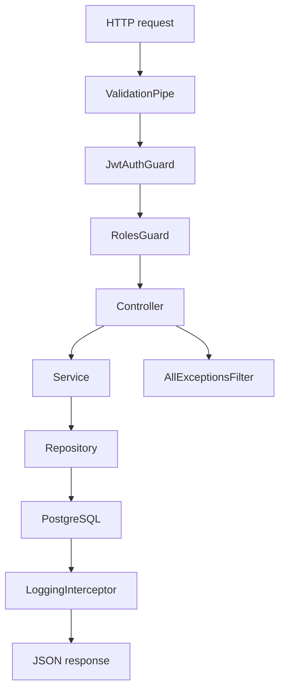

# NestJS LMS developer guidelines and learning guide

This document explains the eLearning Management System that lives in `lms-project`. It is written for someone who can already write basic TypeScript and wants to understand this NestJS application.

The same chapters are exported to `documentation/NESTJS_LMS_LEARNING_GUIDE.pdf`.

## Chapter 1 – Project introduction

### What is this project?

The LMS lets three kinds of people work with courses:

- An admin manages users and can see every course, enrollment, and report.
- An instructor creates courses and manages only the courses they own.
- A learner browses published courses, enrolls, completes lessons, and takes quizzes.

### Technology stack

| Part | Choice | Where |
| --- | --- | --- |
| API | NestJS and TypeScript | `backend/` |
| Database | PostgreSQL and TypeORM | `backend/src/database` |
| Auth | JWT and Passport | `backend/src/modules/auth` |
| UI | React, Vite, Material UI | `frontend/` |
| Tests | Jest and Supertest | `backend/src/**/*.spec.ts` and `backend/test` |

### How the pieces talk

The browser calls Axios. Axios adds the JWT. NestJS checks the token, runs the controller, and the service talks to PostgreSQL through a repository. The JSON response goes back to React.

### Folder structure

```
lms-project/backend/src/modules   feature modules
lms-project/backend/src/common    guards, filter, logging, decorators
lms-project/frontend/src/pages    screens
lms-project/database/seeds        sample users
```

Takeaway: the UI does not decide who is allowed to do something. The API does.

## Chapter 2 – NestJS fundamentals

### What is NestJS?

NestJS is a Node.js framework that organizes an API into modules. A module groups a controller and the services it needs.

### Module

`AuthModule` in `backend/src/modules/auth/auth.module.ts` imports `UsersModule` and `JwtModule`, and registers `AuthService` and `JwtStrategy`.

### Controller

`AuthController` maps URLs to methods. `POST /api/auth/login` calls `AuthService.login`. The controller does not hash passwords or query the database.

### Service and dependency injection

`AuthService` asks for `UsersService` and `JwtService` in its constructor. Nest creates those objects and passes them in. You do not write `new UsersService()`.

### DTO

`RegisterDto` describes the JSON body and the validation rules. A `role` field is not on the DTO, so a caller cannot register as an admin.

### Entity and repository

`User` in `backend/src/modules/users/entities/user.entity.ts` maps to the `users` table. `UsersService` injects `Repository<User>` and calls `findOne` or `save`.

Takeaway: controller receives, service decides, repository reads and writes.

## Chapter 3 – Request lifecycle

For `POST /api/auth/login` the order is:

1. Nest routing matches `AuthController.login`.
2. The global `ValidationPipe` checks `LoginDto`.
3. `AuthService.login` runs.
4. `LoggingInterceptor` records the method, URL, status, and time.
5. If something throws, `AllExceptionsFilter` builds the JSON error.

Protected routes add two guards before the controller: `JwtAuthGuard`, then `RolesGuard`.



Login itself has no JWT guard, because the caller does not have a token yet. `GET /api/auth/me` does.

Takeaway: guards run before the controller. The filter runs when a layer throws.

## Chapter 4 – Backend modules

| Module | Purpose | Main class | Example route |
| --- | --- | --- | --- |
| AuthModule | Register and login | AuthService | POST /api/auth/login |
| UsersModule | Admin user management | UsersService | POST /api/users |
| CoursesModule | Course rules and visibility | CoursesService | POST /api/courses/:id/publish |
| ModulesModule | Course modules | ModulesService | POST /api/courses/:courseId/modules |
| LessonsModule | Lesson content | LessonsService | GET /api/lessons/:id |
| EnrollmentsModule | Enrollment | EnrollmentsService | POST /api/enrollments |
| ProgressModule | Lesson completion | ProgressService | POST /api/progress/lessons/:lessonId/complete |
| AssessmentsModule | Quizzes | AssessmentsService | POST /api/quizzes/:quizId/submit |
| ReportsModule | Dashboard and reports | ReportsService | GET /api/reports/overview |

`ModulesModule` is the Nest feature. The database row is the class `CourseModule` in `course_modules`. Those names are different so Nest's own `@Module` decorator is not confused with a course module.

## Chapter 5 – PostgreSQL and TypeORM

### Entities

Each class with `@Entity` is a table. `@PrimaryGeneratedColumn('uuid')` creates the id. `@Column({ name: 'first_name' })` sets the column name.

### Relationships

`Course.instructor` is many courses to one user. `Enrollment` is unique on `learnerId` and `courseId` because of `@Unique('UQ_enrollments_learner_course', ['learnerId', 'courseId'])` and the same unique constraint in the migration.

### Repository

```typescript
await this.usersRepository.findOne({ where: { email } });
```

That line is in `UsersService.ensureEmailAvailable`.

### QueryBuilder

`CoursesService.findAll` starts a query builder so it can filter by role, search text, and page in one query.

### Transactions

`AssessmentsService.submit` calls `this.dataSource.transaction`. The attempt and its responses are saved together. If the response save fails, the attempt is not left behind.

`ModulesService.reorder` also uses a transaction. It first writes negative sequence numbers, then the final order, so the unique `(course_id, sequence)` constraint is not broken halfway through.

### Migrations and seed

`synchronize` is false in `AppModule` and in `AppDataSource`. The tables are created only by `InitialSchema1732600000000`.

`npm run seed` runs `backend/src/database/seed.ts`. It reads `database/seeds/users.json`, hashes passwords with bcrypt, and inserts courses only when the users table is empty.

Takeaway: change the entity and add a migration. Do not turn `synchronize` on.

## Chapter 6 – Authentication and authorization

### Registration

`AuthService.register` calls `UsersService.create` with `role: UserRole.LEARNER`. The password is hashed with bcrypt cost 10.

### Login

`UsersService.findByEmailWithPassword` loads the hash with `.addSelect('user.password')` because the password column is `select: false`. `bcrypt.compare` checks it. An inactive user receives `Account is inactive`. The token payload is `{ sub, email, role }`. The response user object has no password field. The entity also has `@Exclude()` on `password`, and `ClassSerializerInterceptor` removes it from other responses.

### Passport strategy

`JwtStrategy.validate` loads the user again. A deactivated user cannot keep using an old token.

### Guards and decorator

Put `@UseGuards(JwtAuthGuard, RolesGuard)` on a controller and `@Roles(UserRole.ADMIN)` on a method. `RolesGuard` reads the metadata set by the `@Roles()` decorator.

Ownership is a second check. `CoursesService.assertCanManage` allows an admin, or an instructor whose `id` equals `course.instructorId`.

End-to-end example: a learner calls `POST /api/courses`. `RolesGuard` rejects the role before `CoursesService.create` runs.

Takeaway: role guards are not enough. Services also check ownership.

## Chapter 7 – React frontend integration

### Structure

- `frontend/src/api/client.ts` creates Axios and attaches `Authorization: Bearer`.
- `frontend/src/auth/AuthContext.tsx` stores the token and user in `localStorage`.
- `ProtectedRoute` sends anonymous users to `/login` and sends the wrong role away.
- Pages under `frontend/src/pages` call the API. Dashboard numbers come from `GET /api/reports/overview`.

### Example

`LearningPage` loads `/enrollments/me`, then the course, the progress report, and the quizzes. The Mark complete button calls `POST /api/progress/lessons/:lessonId/complete`. The percentage in the response replaces the progress bar. The page does not calculate the percentage itself.

Takeaway: if the API returns 403, the button cannot bypass it.

## Chapter 8 – Business logic

| Rule | Where | Why there |
| --- | --- | --- |
| Publish needs a title, description, one module, and one lesson | `CoursesService.publish` | Learners must not see an empty course |
| Learners only see published courses | `CoursesService.canView` | Drafts stay private |
| Duplicate enrollment returns 409 | `EnrollmentsService.enroll` plus unique index | The database still protects the rule if the check is skipped |
| Completion percentage | `calculateCompletion` used by `ProgressService.syncAndBuild` | The client cannot send a percentage |
| Zero lessons stays active at 0% | `calculateCompletion` | A course with no lessons is not complete |
| All lessons complete sets `COMPLETED` | `ProgressService.syncAndBuild` | Status is derived, not typed by the client |
| Quiz score | `scoreQuiz` used by `AssessmentsService.submit` | The client sends option ids, not a score |
| Correct answers hidden from learners | `AssessmentsService.shapeQuiz` | Learners see options, not `isCorrect`, before they submit |
| One correct option | `AssessmentsService.assertSingleCorrectOption` | A question with two correct answers would make scoring ambiguous |

## Chapter 9 – Creating a new API

Example: add `GET /api/courses/:id/summary` that returns the title and lesson count.

1. Add a method on `CoursesService` that loads the course with `getVisibleCourse` and counts lessons.
2. Add `@Get(':id/summary')` on `CoursesController`. Keep it above routes that could swallow the path, or give it a distinct path.
3. Reuse the JWT guard already on the controller.
4. Add `@ApiOperation` so Swagger lists it.
5. Add a unit test that mocks the repositories and expects a learner to be rejected for a draft course.
6. Add the request to `postman/LMS.postman_collection.json`.

Do not put the lesson count query in the controller.

## Chapter 10 – Testing

Unit tests live next to services, for example `backend/src/modules/enrollments/enrollments.service.spec.ts`. They construct the service with mock repositories. They do not need PostgreSQL.

The e2e test in `backend/test/app.e2e-spec.ts` boots the real `AppModule`, migrates `DB_NAME_TEST`, and walks through register, login, course creation, publish, enroll, duplicate enroll, lesson completion, quiz submit, and a forbidden edit.

Commands:

```bash
npm test
npm run test:cov
npm run test:e2e
```

Open `backend/coverage/lcov-report/index.html` after `test:cov`.

Takeaway: mock the repository in unit tests. Use Supertest when you need the real guards and validation pipe.

## Chapter 11 – Debugging

| Symptom | What to check |
| --- | --- |
| Nest cannot find a provider | The module `imports` or `providers` array is missing that class. `AuthModule` must import `UsersModule` because `JwtStrategy` needs `UsersService`. |
| Password is undefined on login | `findByEmailWithPassword` must `addSelect('user.password')`. |
| 400 with a list of fields | `ValidationPipe` has `whitelist` and `forbidNonWhitelisted`. Remove extra JSON fields. |
| 401 after login | The Axios client must send `Bearer` plus the token. `JwtStrategy` uses `jwt.secret` from the environment. |
| 403 on your own course | `course.instructorId` must equal the instructor id in the token. |
| Draft course 404 for a learner | `canView` hides drafts. That is intentional. |
| Unique violation 409 | `AllExceptionsFilter` maps Postgres code `23505` to a conflict response. |
| Frontend shows a network error | `CORS_ORIGIN` must be `http://localhost:5173` and `VITE_API_URL` must end in `/api`. |
| Empty dashboard | The API is down or the token belongs to a different role. The numbers are not hardcoded. |

## Chapter 12 – Maintenance

| Change | Files |
| --- | --- |
| Add a column | Entity, a new migration, the DTO, and the service assignment |
| Add an endpoint | DTO if needed, service method, controller method, Swagger decorator, test, Postman |
| Add a module | New folder under `backend/src/modules`, register it in `app.module.ts` |
| Add a role | `UserRole`, the check constraint in a migration, `@Roles`, and the React `homeForRole` map |
| Change progress math | `progress.calculator.ts` and `progress.calculator.spec.ts` |
| Change a relationship | Entity decorators and a migration that edits the foreign key |
| Add a page | A component in `frontend/src/pages` and a `Route` in `App.tsx` |
| Add validation | A class-validator decorator on the DTO |
| Add a test | A `*.spec.ts` beside the service |

## Chapter 13 – Walkthroughs

### 1. Register and login

`RegisterPage` posts to `/auth/register`. `AuthService.register` forces the learner role. `UsersService.create` hashes the password and saves `users`. The screen then goes to login. `LoginPage` posts to `/auth/login`. The token and user are stored by `AuthContext`.

### 2. Instructor creates and publishes a course

`CoursesPage` posts to `/courses`. `CoursesService.create` sets `instructorId` to the logged-in instructor and status `DRAFT`. `CourseBuilderPage` posts modules and lessons. Publish calls `CoursesService.publish`, which counts lessons through a query builder and sets `PUBLISHED`.

### 3. Learner enrolls

`CourseDetailPage` posts `{ courseId }` to `/enrollments`. `EnrollmentsService.enroll` checks the role, the published status, and an existing row. The insert uses status `ACTIVE`. A second click returns 409.

### 4. Learner completes a lesson

`LearningPage` loads the lesson only after enrollment. The button posts to `/progress/lessons/:lessonId/complete`. `ProgressService.markLessonCompleted` checks the lesson belongs to the enrolled course. A second click does not insert another `lesson_progress` row.

### 5. Progress calculation

`ProgressService.syncAndBuild` counts modules, lessons, and completed rows. `calculateCompletion` returns the percentage and status. The enrollment row is updated when the status changes. The page renders `completionPercentage` from that response.

### 6. Quiz submission

`QuizPage` loads `/quizzes/:id`. For a learner, `shapeQuiz` removes `isCorrect`. Submit sends question and option ids. `AssessmentsService.submit` checks every id, calls `scoreQuiz`, and saves `quiz_attempts` and `quiz_responses` in one transaction. The alert shows `PASS` or `FAIL` from the response.

### 7. Progress report

`ProgressPage` calls `/reports/learners/:learnerId/progress`. `ReportsService.learnerProgress` rejects a learner who asks for someone else. An instructor only receives rows for courses they own. Each row is built by `ProgressService.syncAndBuild`.

## Chapter 14 – Quick reference

| Concept | Purpose | Project usage | File or class |
| --- | --- | --- | --- |
| Module | Group a feature | Auth, courses, quizzes | `AuthModule`, `CoursesModule` |
| Controller | Map a URL | Thin methods | `CoursesController` |
| Service | Business rules | Publish, enroll, score | `CoursesService`, `EnrollmentsService`, `AssessmentsService` |
| DTO | Validate input | class-validator | `CreateCourseDto`, `SubmitQuizDto` |
| Entity | Table mapping | TypeORM | `User`, `Course`, `CourseModule`, `Lesson` |
| Repository | Database access | Injected in services | `Repository<Course>` |
| Guard | Allow or reject | JWT and roles | `JwtAuthGuard`, `RolesGuard` |
| Decorator | Attach metadata | Current user and roles | `@CurrentUser()`, `@Roles()` |
| Pipe | Transform and validate | Global | `ValidationPipe` in `main.ts` |
| Interceptor | Log the call | Method, URL, status, time | `LoggingInterceptor` |
| Filter | Consistent errors | No stack traces | `AllExceptionsFilter` |
| Migration | Create tables | No auto schema sync | `InitialSchema1732600000000` |
| Strategy | Read the JWT | Passport | `JwtStrategy` |

Common mistake: returning `course.instructor` without remembering the password column. `select: false` and `@Exclude()` are both there so the hash is not sent.

Another mistake: trusting a score field from the browser. `SubmitQuizDto` has no score field. `scoreQuiz` computes it.
