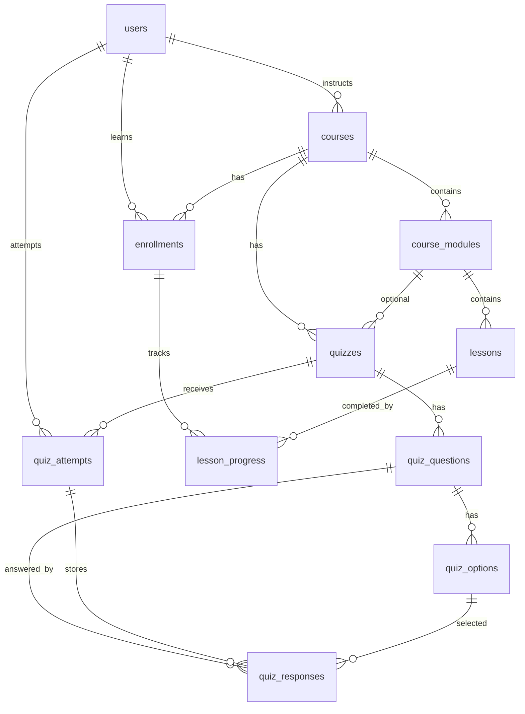

# Database ER diagram

PostgreSQL schema created by `backend/src/database/migrations/1732600000000-InitialSchema.ts`. `synchronize` is false.

## Tables

- `users` — unique email, bcrypt `password`, role `ADMIN | INSTRUCTOR | LEARNER`, `is_active`.
- `courses` — `instructor_id` references `users` and cannot be deleted while courses exist. Status is `DRAFT` or `PUBLISHED`.
- `course_modules` — unique `(course_id, sequence)`. Deleting a course cascades to its modules.
- `lessons` — unique `(module_id, sequence)`. Deleting a module cascades to its lessons.
- `enrollments` — unique `(learner_id, course_id)`. Deleting a course or learner is restricted while enrollments exist.
- `lesson_progress` — unique `(enrollment_id, lesson_id)`. A lesson cannot be deleted while progress points at it.
- `quizzes` — required `course_id`, optional `module_id`. `passing_percentage` is between 1 and 100. Removing a module sets `module_id` to null.
- `quiz_questions` and `quiz_options` — each question is expected to have exactly one correct option. That rule is enforced in `AssessmentsService`.
- `quiz_attempts` — score is stored by the server. A quiz cannot be deleted while attempts exist.
- `quiz_responses` — unique `(attempt_id, question_id)`. `is_correct` is calculated by the server when the attempt is saved.
